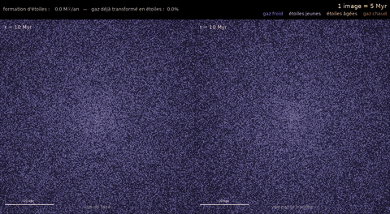
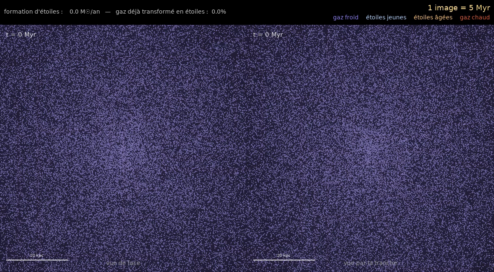
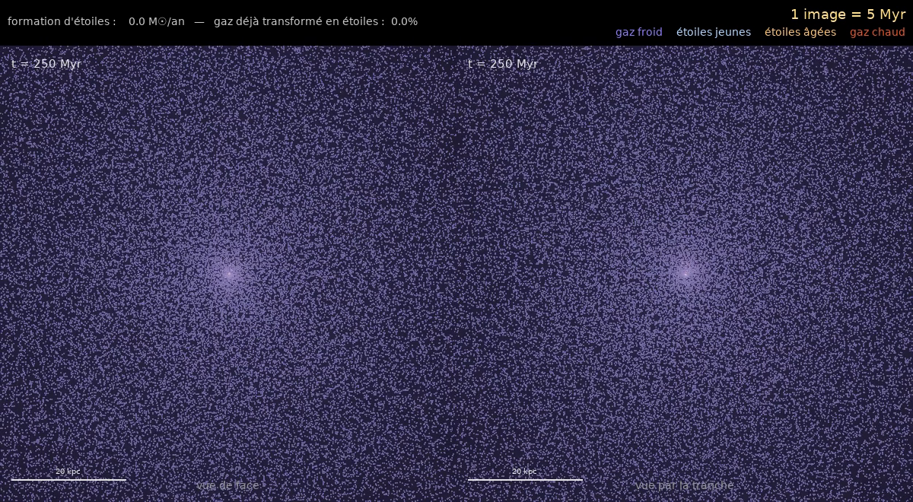
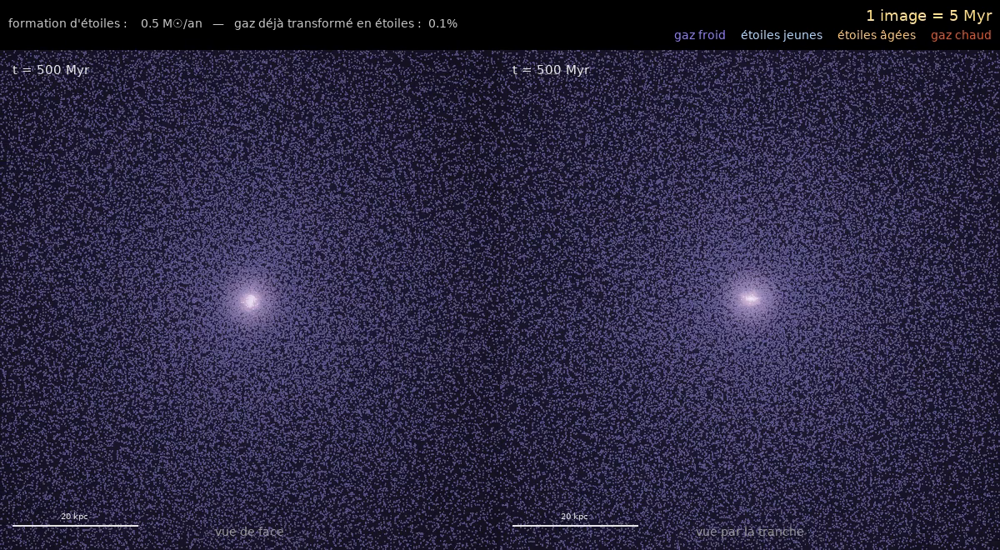
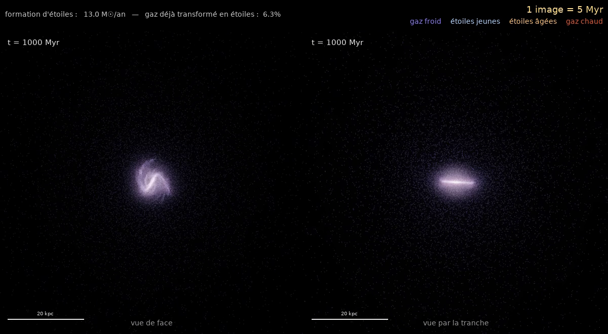
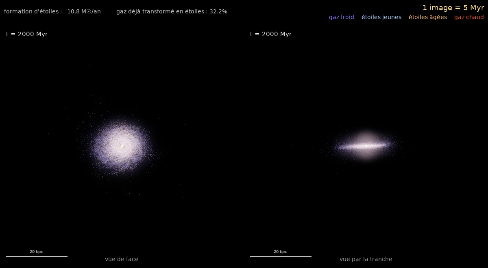
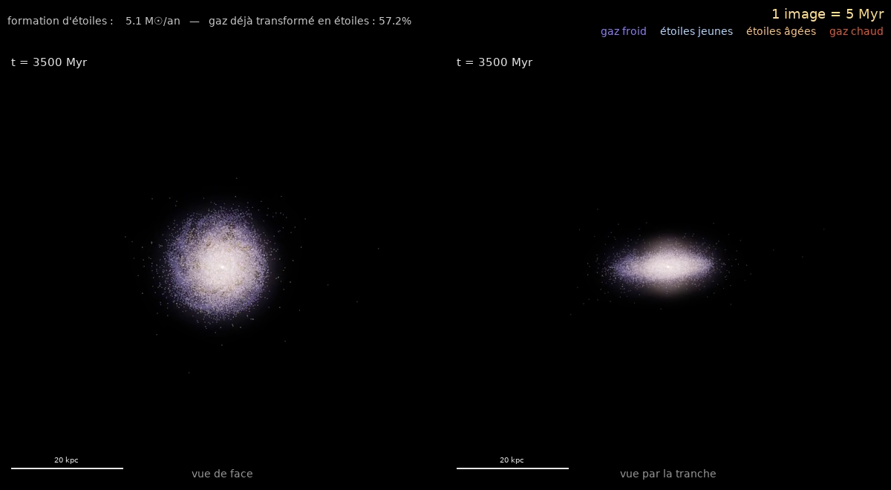
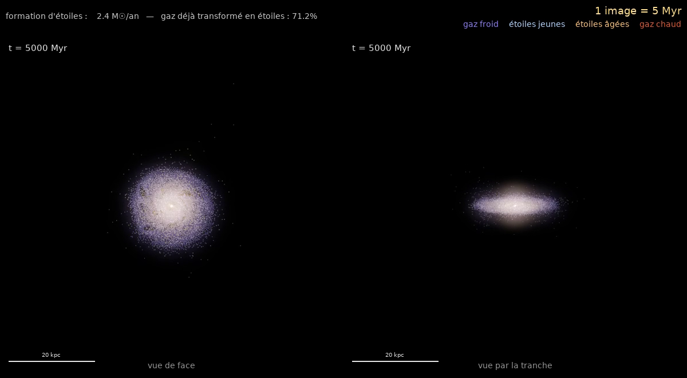

# Formation of a disk galaxy

A self-contained simulation of how a spiral galaxy forms. A cold, slowly rotating cloud of gas
and dark matter collapses under its own gravity. The gas radiates its energy away, settles
into a rotating disk and turns into stars, while supernovae keep star formation in check.

The code combines:
- a **Barnes-Hut tree code** for gravity (C++ / OpenMP);
- **Smoothed Particle Hydrodynamics (SPH)** for the gas (Python + Numba);
- **sub-grid models** for radiative cooling, star formation and supernova feedback.

It writes a video with a face-on view and an edge-on view of the forming galaxy.



*200 000 particles (100 000 gas + 100 000 dark matter), 5 billion years, 1 frame = 5 Myr.
Left: face-on view (looking down the spin axis). Right: edge-on view.
The labels in these images are from the original French version of the code
(gaz froid = cold gas, étoiles jeunes / âgées = young / old stars, gaz chaud = hot gas).*

---

## Contents

1. [What you see](#what-you-see)
2. [Quick start](#quick-start)
3. [Code layout](#code-layout)
4. [Physics and numerics](#physics-and-numerics)
5. [Parameters](#parameters)
6. [Limitations](#limitations)
7. [References](#references)

---

## What you see

Colours:

| Colour | Particles |
|---|---|
| pale blue-violet | cold gas (T < 10⁵ K) |
| blue-white | young stars (< 300 Myr): still contain hot, massive O/B stars |
| yellow-orange | old stars (> 300 Myr): only long-lived G/K/M stars are left |
| dark red | hot halo gas (T > 10⁵ K): shock-heated or heated by supernovae |

Dark matter carries 84 % of the mass but is invisible, as in the real Universe.

The header shows two quantities:
- the **star formation rate** (SFR) in solar masses per year (the Milky Way today: ~1–2 M☉/yr);
- the fraction of the gas already turned into stars.

### t = 0: the initial cloud



The cloud is 100 kpc in radius and holds 2.8 × 10¹¹ M☉: 16 % gas and 84 % dark matter.
It is filled at random, with a density that falls off as 1/r. It is cold and rotates
slowly (spin parameter λ = 0.05). The graininess is Poisson noise: these random density
fluctuations seed the first clumps.

### t = 250 Myr: the centre collapses first



The free-fall time scales as t_ff ∝ 1/√(Gρ), so the dense centre falls in first. The outer
shells follow later. This is the "inside-out" growth of galaxies.

### t = 500 Myr: a bright core forms



Gas streams collide at the centre and are shock-heated. The gas then cools (radiates) and
sinks. The first stars form here: SFR ≈ 0.5 M☉/yr.

### t = 1 Gyr: a small spiral disk



Gas loses energy through shocks and cooling, but it keeps its angular momentum. It cannot fall
straight to the centre: it settles into a thin, rotating disk (Fall & Efstathiou 1980).
The disk is cold and dense, so it is gravitationally unstable and develops spiral arms.
Star formation peaks at ≈ 13 M☉/yr, the typical rate of a young galaxy at redshift ~2.

### t = 2 Gyr: the disk grows



Gas from the outer cloud keeps raining in. It carries more angular momentum, so it lands at
larger radii and the disk grows outwards. A third of the gas has turned into stars
(SFR ≈ 11 M☉/yr).

### t = 3.5 Gyr and 5 Gyr: a mature galaxy




As the gas reservoir empties, star formation drops (5 then 2.4 M☉/yr). The galaxy turns from
blue to yellow-orange as old stars come to dominate.

The final object has:
- a dense, round central bulge;
- a stellar disk ~20 kpc across (the edge-on view shows it with a thickness of a few kpc).

71 % of the gas has become stars. Supernova feedback kept the remaining gas from being used
up at once.

---

## Quick start

Requirements: Python ≥ 3.9, a C++17 compiler with OpenMP (`g++`), and `ffmpeg`.

```bash
pip install -r requirements.txt

python main.py                                          # 10 000 particles, 5 Gyr
python main.py --gyr 1 --size 400                       # quick look at the first Gyr
python main.py --n-gas 100000 --n-dm 100000 --save galaxy_N200000.mp4   # the video above

python tests/test_physics.py                            # sanity checks
```

The C++ engine compiles itself into `build/libnbody.so` on the first run. You can also build it
with `make -C cpp`.

All options and their defaults are listed by `python main.py --help`.

Typical wall-clock times on an 8-core desktop, for 5 Gyr:

| Particles (gas + DM) | Time |
|---|---|
| 10 000 | ~10 min |
| 40 000 | ~1.6 h |
| 200 000 | ~17 h |

The cost grows quickly once the disk forms: dense gas needs short time steps.

---

## Code layout

```
formation_galaxie_projet/
├── main.py                       command line, main loop (simulate → render → encode)
├── galaxy_formation/
│   ├── units.py                  code units (G = 1) and physical constants
│   ├── config.py                 all parameters, with defaults
│   ├── engine.py                 ctypes wrapper of the C++ engine (compiles it if needed)
│   ├── initial_conditions.py     the rotating cloud of gas + dark matter
│   ├── sph.py                    SPH kernel, forces, neighbour search
│   ├── cooling.py                radiative cooling of primordial gas
│   ├── star_formation.py         star formation and supernova feedback
│   ├── simulation.py             particle state, forces, hierarchical leapfrog
│   ├── rendering.py              colours, disk frame, camera, tone mapping
│   └── video.py                  frame layout, ffmpeg output
├── cpp/
│   ├── nbody.cpp                 Barnes-Hut gravity + particle rendering (OpenMP, SIMD)
│   └── Makefile
├── tests/test_physics.py         Barnes-Hut vs direct sum, kernel normalisation, ...
└── docs/images/                  frames of the 200 000-particle video
```

One time step, schematically:

```
main.py ── GalaxyFormation.advance_to(t_frame)          [simulation.py]
             └─ step(): hierarchical KDK leapfrog
                  ├─ accelerations()
                  │    ├─ Engine.gravity()  ........ Barnes-Hut tree        [engine.py → nbody.cpp]
                  │    └─ _hydro()
                  │         ├─ NeighbourFinder ..... 32 nearest neighbours  [sph.py]
                  │         └─ sph_forces() ........ ρ, pressure, viscosity [sph.py]
                  ├─ _thermodynamics() ............. shock heating + cooling [cooling.py]
                  └─ _stars() ...................... star formation + SNe  [star_formation.py]
        FrameMaker(sim)                                  [video.py]
             └─ DiskTracker → Camera.render → tone mapping [rendering.py → nbody.cpp]
```

---

## Physics and numerics

### Units

The code uses G = 1. The length unit is 3.5 kpc and the mass unit is 4 × 10¹⁰ M☉. This
gives a velocity unit of ≈ 222 km/s and a time unit of ≈ 15.4 Myr. Every input and output
is in physical units; `units.py` converts them.

### 1. Initial conditions (`initial_conditions.py`)

Particles are placed at random in a sphere of radius R₀ = 100 kpc, with M(<r) ∝ r²
(density ρ ∝ 1/r). The option `--profile uniform` gives a uniform sphere instead.
Gas and dark matter are mixed in the cosmic proportion f_b ≈ 0.16 (Planck 2018).

The rotation is set by the **spin parameter** λ = J|E|^½ / (G M^{5/2}) (Peebles 1969).
Dark-matter halos in cosmological simulations have λ ≈ 0.035–0.05 (Bullock et al. 2001).
The azimuthal velocity is v_φ = κ v_c(r) R/r, with v_c = √(GM(<r)/r) and κ = λ/0.47.

A random isotropic velocity of 10 % of the virial velocity is added: the cloud is almost
cold. Its collapse resembles the classic "monolithic" scenario (Eggen, Lynden-Bell & Sandage
1962), with gas cooling inside a dark halo (White & Rees 1978).

### 2. Gravity: Barnes-Hut tree (`cpp/nbody.cpp`)

The exact force costs O(N²). The **Barnes-Hut algorithm** (Barnes & Hut 1986) cuts this to
O(N log N):
- space is recursively divided into an octree;
- a distant cell is replaced by its total mass at its centre of mass, provided it is seen
  under an angle smaller than θ = 0.7.

Optimisations in the engine:
- **Group walk** (Barnes 1990). Neighbouring particles (≤ 64) share one tree walk. The
  walk produces an interaction list, which is evaluated with SIMD-vectorised single-precision
  arithmetic.
- **Parallel construction**. The top of the tree is split into independent sub-trees,
  built in parallel with OpenMP.
- **Refit**. During sub-steps the tree is not rebuilt. Only its masses and centres of mass are
  updated, and its opening radii are enlarged by the largest particle displacement.

The force is **softened** (Plummer, ε = 0.4 kpc):

$$\mathbf a_i = \sum_j \frac{G m_j (\mathbf r_j - \mathbf r_i)}{(|\mathbf r_j - \mathbf r_i|^2 + \varepsilon^2)^{3/2}}$$

Each particle stands for ~10⁶ M☉. Softening suppresses the unphysical two-body
encounters between such heavy particles (Dehnen 2001).

`tests/test_physics.py` checks that the median relative force error, against the exact
O(N²) sum, is below 1 %.

### 3. Gas: Smoothed Particle Hydrodynamics (`sph.py`)

SPH (Lucy 1977; Gingold & Monaghan 1977) represents a fluid by particles. Fluid quantities are
kernel-weighted averages over the N_ngb = 32 nearest neighbours. The kernel W is the
cubic spline of Monaghan & Lattanzio (1985), and h_i is half the distance to the 32nd
neighbour:

$$\rho_i = \sum_j m_j W(r_{ij}, h_i), \qquad P_i = (\gamma - 1)\rho_i u_i, \quad \gamma = 5/3$$

$$\frac{d\mathbf v_i}{dt} = -\sum_j m_j \left[\frac{P_i}{\rho_i^2}\nabla_i W(h_i) + \frac{P_j}{\rho_j^2}\nabla_i W(h_j) + \Pi_{ij}\,\overline{\nabla_i W}\right]$$

$$\frac{du_i}{dt} = \sum_j m_j \left[\frac{P_i}{\rho_i^2}\nabla_i W(h_i) + \tfrac12 \Pi_{ij}\,\overline{\nabla_i W}\right]\cdot \mathbf v_{ij}$$

**Shocks.** Π_ij is the artificial viscosity of Monaghan & Gingold (1983), with α = 1 and
β = 2. It acts only on approaching pairs:

$$\Pi_{ij} = \frac{-\alpha\,\bar c_{ij}\,\mu_{ij} + \beta\,\mu_{ij}^2}{\bar\rho_{ij}}, \qquad \mu_{ij} = \frac{\bar h_{ij}\,\mathbf v_{ij}\cdot\mathbf r_{ij}}{r_{ij}^2 + 0.01\bar h_{ij}^2}$$

It turns the kinetic energy of colliding gas streams into heat. This is the key to disk
formation: cooling then radiates this heat away. Energy is lost, angular momentum is
conserved, and the gas spirals into a disk.

**Neighbour search.** A full search uses a k-d tree (scipy). It keeps 48 candidates per
particle (a Verlet list); during sub-steps the 32 nearest neighbours are re-selected among
these candidates only.

**Resolution floor.** h is never smaller than ε/2, so no hydrodynamic structure is smaller
than the gravitational resolution (Bate & Burkert 1997).

See Monaghan (1992, 2005) and Springel (2010) for reviews.

### 4. Radiative cooling (`cooling.py`)

Hot gas loses internal energy at the rate

$$\frac{du}{dt} = -\frac{\Lambda(T)\,n_H^2}{\rho}$$

The cooling function Λ(T) contains three terms:
- collisional excitation of H and He⁺, fitted by Cen (1992);
- free-free emission (bremsstrahlung), dominant above ~10⁷ K;
- nothing below 10⁴ K, where a gas without metals or molecules hardly radiates. The
  temperature is floored at that value.

The update is explicit. It is bounded so that it never jumps below the floor.

### 5. Star formation (`star_formation.py`)

One particle weighs ~10⁶ M☉, so stars cannot be resolved individually. A gas particle turns
as a whole into a "star particle" that represents a stellar population (Katz 1992; Springel
& Hernquist 2003).

The gas must be dense (n_H > 1 cm⁻³, the density of a galactic disk) and cold
(T < 3 × 10⁴ K). It then forms stars at

$$\dot\rho_\star = \epsilon_{ff}\frac{\rho}{t_{ff}}, \qquad t_{ff} = \sqrt{\frac{3\pi}{32\,G\rho}}, \qquad \epsilon_{ff} = 0.5\,\%$$

A few per cent per free-fall time is what is observed in molecular clouds
(Krumholz & Tan 2007). Together with the threshold, this reproduces the
Kennicutt-Schmidt law Σ_SFR ∝ Σ_gas^1.4 (Schmidt 1959; Kennicutt 1998).

The conversion is stochastic: during dt, a particle becomes a star with probability
p = 1 − exp(−ε_ff dt / t_ff).

### 6. Supernova feedback (`star_formation.py`)

For a standard initial mass function (Kroupa 2001), about one star in ~100 M☉ formed is
massive enough (> 8 M☉) to explode, and each supernova releases ~10⁵¹ erg. That makes
~10⁴⁹ erg per solar mass formed.

A fraction of this energy (40 %) heats the 16 nearest gas particles of each new star. Their
cooling is switched off for 30 Myr, the lifetime of a supernova bubble. This is the
"blast-wave" model of Stinson et al. (2006).

Without this step, all the gas would turn into stars within a few dynamical times. With it,
star formation regulates itself and the disk keeps gas for billions of years.

### 7. Time integration (`simulation.py`)

The integrator is a kick-drift-kick **leapfrog**: second-order and symplectic for gravity.

It uses **hierarchical time steps** (Quinn et al. 1997; Springel 2005), on two levels:
- every particle has an admissible step: Δt = 0.3 √(ε/|a|), and also the Courant condition
  Δt = 0.3 h / (c + 1.2(αc + β max μ)) for gas (Monaghan 1992);
- the long step D is the 10th percentile of these steps. "Slow" particles (mostly dark matter
  in the outer halo) are kicked once per D;
- gas and "fast" particles take sub-steps within D. Only their gravity is recomputed, on a
  refitted tree.

### 8. Rendering (`rendering.py`, `video.py`)

**Disk frame.** At each frame the code finds the centre and spin axis of the inner half of the
baryons. It smooths them in time and rotates the scene so that the disk is seen exactly
face-on and edge-on.

**Projection.** Baryons are projected orthographically into one count map per colour group.
The maps are tone-mapped together:

$$l_g = \frac{\ln(1 + K\,n_g/n_{ref})}{\ln(1+K)} + \text{glow}_g, \qquad \text{RGB} = 1 - e^{-\,\text{exposure}\,\sum_g l_g\,\mathbf c_g}$$

- The logarithm brings out faint spiral arms next to the bright bulge.
- The glow is a blurred, down-sampled copy of the image; it mimics scattered light.
- The exponential saturates smoothly to white.
- n_ref is the 99.9th percentile of the image, smoothed in time to avoid flicker.

---

## Parameters

| Option | Default | Meaning |
|---|---|---|
| `--n-gas`, `--n-dm` | 5000, 5000 | number of gas / dark-matter particles |
| `--mass` | 2.8e11 | total mass (M☉) |
| `--f-baryon` | 0.16 | gas fraction of the mass |
| `--profile` | extended | `extended` (ρ ∝ 1/r) or `uniform` |
| `--r0` | 100 | cloud radius (kpc) |
| `--spin` | 0.05 | spin parameter λ |
| `--t-gas` | 1e4 | initial gas temperature (K) |
| `--n-sf` | 1.0 | star-formation density threshold (cm⁻³) |
| `--sf-eff` | 0.005 | star-formation efficiency per free-fall time |
| `--fb-eff` | 0.4 | supernova energy coupled to the gas (× 10⁴⁹ erg/M☉) |
| `--fb-ngb` | 16 | gas neighbours heated per supernova event |
| `--fb-myr` | 30 | cooling shut-off after heating (Myr) |
| `--eps` | 0.4 | gravitational softening (kpc) |
| `--theta` | 0.7 | Barnes-Hut opening angle |
| `--gyr` | 5 | simulated time (Gyr) |
| `--myr-per-frame` | 5 | simulated time per video frame (Myr) |
| `--view` | 40 | half-width of the views (kpc) |
| `--size` | 600 | size of each view (pixels) |
| `--fps` | 30 | frames per second |
| `--seed` | 3 | random seed |
| `--save` | galaxy_formation.mp4 | output file |

Things to try:
- `--spin 0.02`: a compact, bulge-dominated galaxy.
- `--spin 0.1`: a large, extended disk.
- `--fb-eff 0`: no supernovae, so the gas is used up almost at once.
- `--profile uniform`: everything collapses at the same time.

---

## Limitations

This is an idealised, educational model, not a cosmological simulation.

- **Isolated cloud.** Real galaxies grow inside the cosmic web, through filaments and
  mergers (hierarchical ΛCDM). There is no cosmic expansion and no external accretion here.
- **Resolution.** One particle weighs ~10⁶ M☉ (at N = 200 000) and the softening is
  0.4 kpc. The thin disk (~0.3 kpc in the Milky Way) is therefore too thick, and
  structures below ~1 kpc are not resolved.
- **Cooling.** The fit is applied as Λ(T) n_H² with every H and He ion abundance set to one.
  This overestimates cooling well above 10⁴ K, so in practice the gas outside supernova bubbles
  stays very close to the 10⁴ K floor (an almost isothermal gas). There are no metals, no
  molecular cooling and no UV background.
- **Sub-grid physics.** Star formation and feedback are simple recipes. There are no stellar
  winds, no chemical enrichment, no stellar mass loss and no central black hole.
- **Standard SPH.** It handles mixing and contact discontinuities poorly (Agertz et al. 2007).
  Modern codes use pressure-entropy SPH, moving meshes or adaptive mesh refinement.

---

## References

**Gravity and integration**
- Barnes, J. & Hut, P. 1986, *A hierarchical O(N log N) force-calculation algorithm*, Nature 324, 446. [doi:10.1038/324446a0](https://doi.org/10.1038/324446a0)
- Barnes, J. 1990, *A modified tree code: don't laugh; it runs*, J. Comput. Phys. 87, 161. [doi:10.1016/0021-9991(90)90232-P](https://doi.org/10.1016/0021-9991(90)90232-P)
- Dehnen, W. 2001, *Towards optimal softening in three-dimensional N-body codes*, MNRAS 324, 273. [doi:10.1046/j.1365-8711.2001.04237.x](https://doi.org/10.1046/j.1365-8711.2001.04237.x)
- Quinn, T. et al. 1997, *Time stepping N-body simulations*. [arXiv:astro-ph/9710043](https://arxiv.org/abs/astro-ph/9710043)
- Springel, V. 2005, *The cosmological simulation code GADGET-2*, MNRAS 364, 1105. [doi:10.1111/j.1365-2966.2005.09655.x](https://doi.org/10.1111/j.1365-2966.2005.09655.x)

**SPH**
- Lucy, L. B. 1977, AJ 82, 1013. [doi:10.1086/112164](https://doi.org/10.1086/112164)
- Gingold, R. A. & Monaghan, J. J. 1977, MNRAS 181, 375. [doi:10.1093/mnras/181.3.375](https://doi.org/10.1093/mnras/181.3.375)
- Monaghan, J. J. & Gingold, R. A. 1983, *Shock simulation by the particle method SPH*, J. Comput. Phys. 52, 374. [doi:10.1016/0021-9991(83)90036-0](https://doi.org/10.1016/0021-9991(83)90036-0)
- Monaghan, J. J. & Lattanzio, J. C. 1985, A&A 149, 135. [ADS](https://ui.adsabs.harvard.edu/abs/1985A%26A...149..135M)
- Monaghan, J. J. 1992, *Smoothed particle hydrodynamics*, ARA&A 30, 543. [doi:10.1146/annurev.aa.30.090192.002551](https://doi.org/10.1146/annurev.aa.30.090192.002551)
- Monaghan, J. J. 2005, *Smoothed particle hydrodynamics*, Rep. Prog. Phys. 68, 1703. [doi:10.1088/0034-4885/68/8/R01](https://doi.org/10.1088/0034-4885/68/8/R01)
- Bate, M. R. & Burkert, A. 1997, MNRAS 288, 1060. [doi:10.1093/mnras/288.4.1060](https://doi.org/10.1093/mnras/288.4.1060)
- Springel, V. 2010, *Smoothed particle hydrodynamics in astrophysics*, ARA&A 48, 391. [doi:10.1146/annurev-astro-081309-130914](https://doi.org/10.1146/annurev-astro-081309-130914)
- Agertz, O. et al. 2007, *Fundamental differences between SPH and grid methods*, MNRAS 380, 963. [doi:10.1111/j.1365-2966.2007.12183.x](https://doi.org/10.1111/j.1365-2966.2007.12183.x)

**Cooling, star formation, feedback**
- Cen, R. 1992, ApJS 78, 341. [doi:10.1086/191630](https://doi.org/10.1086/191630)
- Katz, N., Weinberg, D. H. & Hernquist, L. 1996, ApJS 105, 19. [doi:10.1086/192305](https://doi.org/10.1086/192305)
- Katz, N. 1992, ApJ 391, 502. [doi:10.1086/171366](https://doi.org/10.1086/171366)
- Springel, V. & Hernquist, L. 2003, MNRAS 339, 289. [doi:10.1046/j.1365-8711.2003.06206.x](https://doi.org/10.1046/j.1365-8711.2003.06206.x)
- Stinson, G. et al. 2006, *Star formation and feedback in SPH simulations I*, MNRAS 373, 1074. [doi:10.1111/j.1365-2966.2006.11097.x](https://doi.org/10.1111/j.1365-2966.2006.11097.x)
- Schmidt, M. 1959, ApJ 129, 243. [doi:10.1086/146614](https://doi.org/10.1086/146614)
- Kennicutt, R. C. 1998, ApJ 498, 541. [doi:10.1086/305588](https://doi.org/10.1086/305588)
- Krumholz, M. R. & Tan, J. C. 2007, ApJ 654, 304. [doi:10.1086/509101](https://doi.org/10.1086/509101)
- Kroupa, P. 2001, *On the variation of the initial mass function*, MNRAS 322, 231. [doi:10.1046/j.1365-8711.2001.04022.x](https://doi.org/10.1046/j.1365-8711.2001.04022.x)

**Galaxy formation**
- Eggen, O. J., Lynden-Bell, D. & Sandage, A. R. 1962, ApJ 136, 748. [doi:10.1086/147433](https://doi.org/10.1086/147433)
- Peebles, P. J. E. 1969, *Origin of the angular momentum of galaxies*, ApJ 155, 393. [doi:10.1086/149876](https://doi.org/10.1086/149876)
- White, S. D. M. & Rees, M. J. 1978, MNRAS 183, 341. [doi:10.1093/mnras/183.3.341](https://doi.org/10.1093/mnras/183.3.341)
- Fall, S. M. & Efstathiou, G. 1980, *Formation and rotation of disc galaxies with haloes*, MNRAS 193, 189. [doi:10.1093/mnras/193.2.189](https://doi.org/10.1093/mnras/193.2.189)
- Mo, H. J., Mao, S. & White, S. D. M. 1998, *The formation of galactic discs*, MNRAS 295, 319. [doi:10.1046/j.1365-8711.1998.01227.x](https://doi.org/10.1046/j.1365-8711.1998.01227.x)
- Bullock, J. S. et al. 2001, *A universal angular momentum profile for galactic halos*, ApJ 555, 240. [doi:10.1086/321477](https://doi.org/10.1086/321477)
- Planck Collaboration 2020, *Planck 2018 results VI. Cosmological parameters*, A&A 641, A6. [doi:10.1051/0004-6361/201833910](https://doi.org/10.1051/0004-6361/201833910)

**Textbook**
- Mo, H., van den Bosch, F. & White, S. 2010, *Galaxy Formation and Evolution*, Cambridge University Press.
